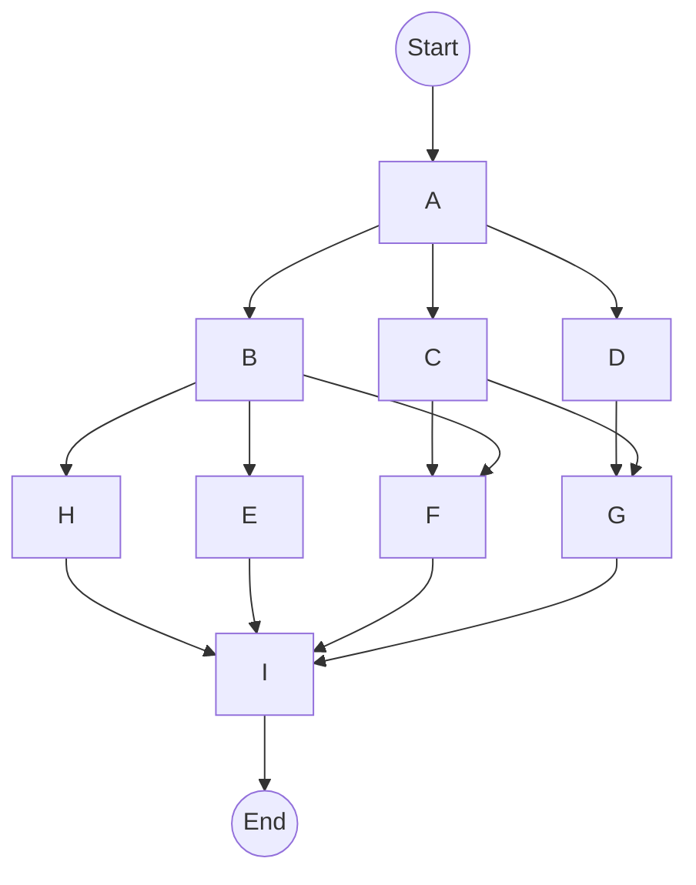

# Направленные ациклические графы (DAG)

Компонент `hyperf/dag` представляет собой легковесную библиотеку для оркестрации задач на основе направленных ациклических графов (**D**irected **A**cyclic **G**raph).

## Назначение

Представьте набор задач:

- Если между задачами есть строгая зависимость, они должны выполняться строго последовательно.
- Если задачи полностью независимы, их можно запустить конкурентно в отдельных корутинах для максимальной скорости.
- В реальных проектах чаще всего встречается смешанный сценарий: часть задач зависит от результатов предыдущих шагов, а часть может выполняться параллельно.

Такие сложные сценарии зависимостей эффективно решаются с помощью абстракции `DAG`.

## Установка

```bash
composer require hyperf/dag
```

## Пример использования


<details>
<summary>Исходный код диаграммы (Mermaid)</summary>



</details>

В графе выше вершины представляют собой задачи, а ребра — зависимости:
- `B`, `C`, `D` могут запуститься только после завершения `A`.
- `H`, `E`, `F` зависят от `B`.
- Финальная задача `I` ожидает завершения `H`, `E`, `F`, `G`.

С помощью `hyperf/dag` этот граф реализуется следующим кодом:

```php
<?php
use Hyperf\Dag\Dag;
use Hyperf\Dag\Vertex;

$dag = new Dag();

$a = Vertex::make(function() { sleep(1); echo "A\n"; });
$b = Vertex::make(function() { sleep(1); echo "B\n"; });
$c = Vertex::make(function() { sleep(1); echo "C\n"; });
$d = Vertex::make(function() { sleep(1); echo "D\n"; });
$e = Vertex::make(function() { sleep(1); echo "E\n"; });
$f = Vertex::make(function() { sleep(1); echo "F\n"; });
$g = Vertex::make(function() { sleep(1); echo "G\n"; });
$h = Vertex::make(function() { sleep(1); echo "H\n"; });
$i = Vertex::make(function() { sleep(1); echo "I\n"; });

$dag->addVertex($a)
    ->addVertex($b)
    ->addVertex($c)
    ->addVertex($d)
    ->addVertex($e)
    ->addVertex($f)
    ->addVertex($g)
    ->addVertex($h)
    ->addVertex($i)
    ->addEdge($a, $b)
    ->addEdge($a, $c)
    ->addEdge($a, $d)
    ->addEdge($b, $h)
    ->addEdge($b, $e)
    ->addEdge($b, $f)
    ->addEdge($c, $f)
    ->addEdge($c, $g)
    ->addEdge($d, $g)
    ->addEdge($h, $i)
    ->addEdge($e, $i)
    ->addEdge($f, $i)
    ->addEdge($g, $i);

// Выполняется в среде корутин
$dag->run();
```

Порядок вывода:

```text
// Через 1 сек
A
// Через 2 сек
D
C
B
// Через 3 сек
G
F
E
H
// Через 4 сек
I
```

> `DAG` планирует задачи по принципу максимальной готовности зависимостей.

## Доступ к результатам предыдущих шагов

Каждая задача может принимать аргумент `$results` — ассоциативный массив, содержащий результаты всех предшествующих шагов. После завершения метод `run()` возвращает итоговый массив со всеми результатами:

```php
<?php
use Hyperf\Dag\Dag;
use Hyperf\Dag\Vertex;

$dag = new Dag();
$a = Vertex::make(function() { return 1; });
$b = Vertex::make(function($results) use ($a) {
    return $results[$a->key] + 1;
});

$results = $dag->addVertex($a)->addVertex($b)->addEdge($a, $b)->run();

assert($results[$a->key] === 1);
assert($results[$b->key] === 2);
```

## Способы определения задач

### Через замыкания

```php
// Второй параметр — опциональный строковый ключ вершины в массиве результатов
Vertex::make(function() { return 'hello'; }, "greeting");
```

### Через класс с интерфейсом Runner

Любой класс, реализующий `Hyperf\Dag\Runner`, можно превратить в вершину графа с помощью `Vertex::of`:

```php
use Hyperf\Dag\Runner;
use Hyperf\Dag\Vertex;

class MyJob implements Runner 
{
    public function run($results = []) 
    {
        return 'hello';
    }
}

Vertex::of(new MyJob(), "greeting");
```

### Вложенные подграфы

Сам класс `Dag` также реализует `Runner`, поэтому графы можно вкладывать друг в друга как подзадачи:

```php
<?php
use Hyperf\Dag\Dag;
use Hyperf\Dag\Vertex;

$a = Vertex::make(function () { return 1; });
$b = Vertex::make(function () { return 2; });
$c = Vertex::make(function () { return 3; });

$nestedDag = new Dag();
$nestedDag->addVertex($a)->addVertex($b)->addEdge($a, $b);
$d = Vertex::of($nestedDag);

$superDag = new Dag();
$superDag->addVertex($c)->addVertex($d)->addEdge($c, $d);
$superDag->run();
```

## Управление уровнем параллелизма

Метод `setConcurrency(int $n)` позволяет ограничить максимальное количество одновременно выполняемых корутин в рамках графа (по умолчанию: 10).
